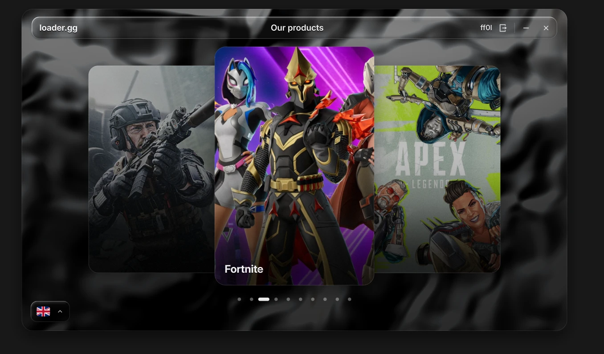
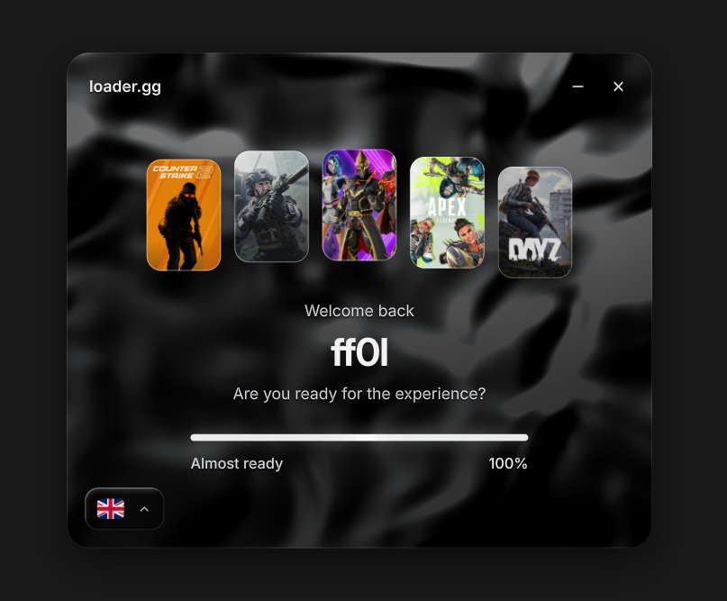
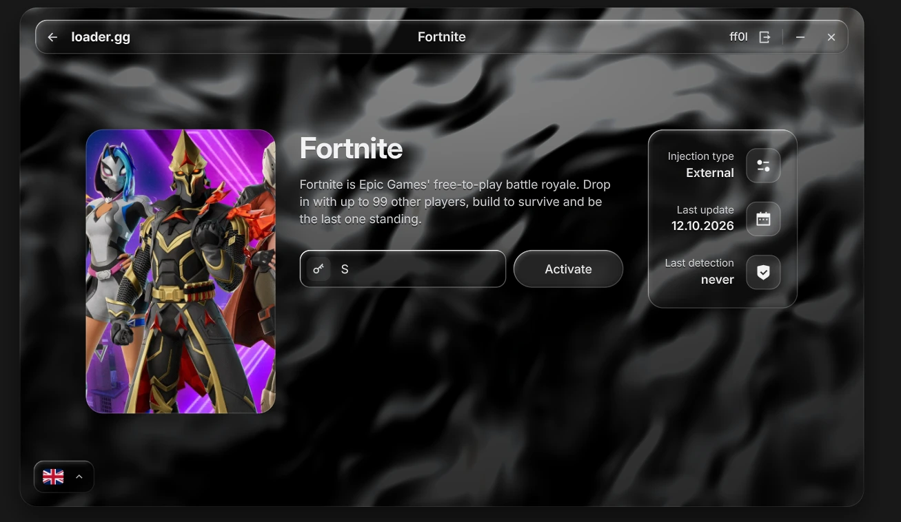

# loader.gg

A Windows desktop loader with a hand-built, GPU-rendered "liquid glass" interface. No Electron, no web view, no Dear ImGui: the UI framework, renderer, text stack and widgets are written from scratch in C++23 on top of Direct3D 11.

> The backend is mocked. Sign-in, registration and license activation run against a local fake service, and **Load** returns to the menu without launching anything.

<p align="center">
  
</p>

<p align="center">
  
  &nbsp;
  
</p>

## Features

- **Liquid glass UI**: refractive glass surfaces with bevels, rim light and chromatic dispersion, over an animated backdrop that reacts to the cursor and to clicks.
- **Own rendering stack**: batched SDF shapes, MSDF text (FreeType + HarfBuzz + msdfgen), embedded fonts, images and flags decoded with WIC, all on Direct3D 11 with DirectComposition.
- **Retained widget tree**: flex layout, focus and keyboard navigation, springs and eased animations, screen transitions that morph the panel.
- **Screens**: sign in with *remember me* (DPAPI-encrypted vault), registration, a welcome screen with a staged progress bar, a 3D product carousel, and product pages with key activation and license duration.
- **9 languages**: English, Deutsch, Español, Русский, Français, Português, Türkçe, Polski, Italiano. They switch live, and the choice is saved.
- **Respects the system**: per-monitor DPI, reduced motion when Windows animations are off, IME positioning, window drag clamped to the work area.
- **Single executable**: static CRT, all assets embedded as resources.

## Requirements

- Windows 10 or 11 (x64)
- Visual Studio 2026 with the *Desktop development with C++* workload (MSVC and the Windows SDK)
- CMake 3.25 or newer
- An internet connection for the first configure (FreeType, HarfBuzz and msdfgen are downloaded with CMake `FetchContent`)

## Build

```bat
build.bat            :: Release
build.bat Debug
```

The executable is written to `build\bin\<Config>\loader.gg.exe`. CMake's own files go to `build\intermediate\`, which also contains the Visual Studio solution (`loader_gg.slnx`).

Link-time optimisation is off by default; enable it with `cmake --preset default -DLOADER_ENABLE_LTO=ON`.

## Trying it out

| Action | What to enter |
| --- | --- |
| Sign in / register | any username with at least 3 characters and a password with at least 6 |
| Activate a product | a 16-character key such as `DAY1-AAAA-BBBB-CCCC` (1 day), `WEEK-…` (1 week) or `LIFE-…` (lifetime); other keys get a duration from their checksum |

Debug builds also simulate failures: usernames `error.invalid`, `error.network`, `error.locked` and `taken.name`, and keys starting with `ZZZZ` (invalid) or `NNNN` (network error).

Settings and the saved login live in `%LOCALAPPDATA%\loader.gg\`.

## Project layout

```
assets/     fonts, game artwork and flags, embedded through assets.rc
external/   third-party dependencies (FetchContent)
shaders/    HLSL, compiled to headers at build time
src/
  app/        application loop, scheduler, clipboard
  auth/       auth service interface, mock service, validation
  core/       geometry, colour, input, UTF and secure memory helpers
  gpu/        D3D11 device, swap chain, composition
  platform/   window, DPI, message loop, resources, image decoding
  render/     draw list, renderer, UI pass
  screens/    login, register, welcome, main, product, shell and router
  storage/    paths, DPAPI vault, settings, logs
  text/       fonts, shaping, MSDF glyph cache
  ui/         widgets, layout, input routing, animation, theme, localisation
```

## Credits

Built with [FreeType](https://freetype.org), [HarfBuzz](https://harfbuzz.github.io) and [msdfgen](https://github.com/Chlumsky/msdfgen). The fonts are [Inter](https://rsms.me/inter/) and [Remix Icon](https://remixicon.com), and the flags come from [flagcdn.com](https://flagcdn.com). Game names and artwork belong to their respective owners.
